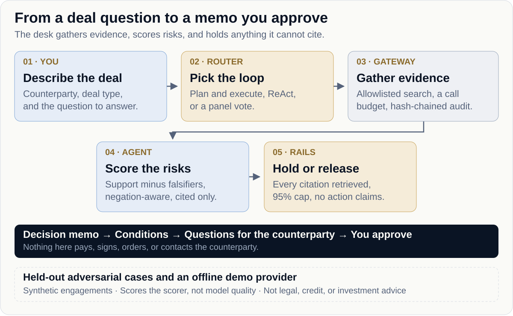

# David

[](https://github.com/BobbY-24/David/actions/workflows/ci.yml)   

**Check a customer, vendor, or acquisition before you commit money — with a memo that cites every record it used.**
Synthetic engagements and an offline demo scorer. No model calls. Nothing here is legal, credit, or investment advice.

[Quick start](#quick-start) · [Engagements](#engagements) · [How it decides](docs/CONTROL_PLANE.md) · [Job service](docs/JOB_SERVICE.md) · [Docs](#documentation)

<picture>
  <source media="(max-width: 760px)" srcset="assets/workflow-mobile.svg">
  
</picture>

## Quick start

Paste into **Claude Code, Codex or another local coding agent**:

```text
Set up David from https://github.com/BobbY-24/David.
Install Flutter 3.47.7 if it is missing, run flutter pub get and
flutter test, then serve the desk on 127.0.0.1:43123 and open it.
```

Flutter 3.47 or newer · runs offline, no keys needed.

**Or run the full stack with Docker.** This adds the job service, Postgres, and Redis, so the Jobs tab works. Docker Desktop or Docker Engine with Compose is required.

```sh
gh repo clone BobbY-24/David
cd David
docker compose -f service/docker-compose.yml up --build -d
flutter run -d web-server --web-hostname 127.0.0.1 --web-port 43123
```

Open http://127.0.0.1:43123. The job API runs on http://127.0.0.1:43124, on this machine only. The key vault's master key is created in the `david-data` volume. Stop the services with `docker compose -f service/docker-compose.yml down`.

<details>
<summary>Prefer manual setup? Copy these commands.</summary>

```sh
gh repo clone BobbY-24/David
cd David
flutter pub get
flutter test
flutter run -d web-server --web-hostname 127.0.0.1 --web-port 43123
```

Open http://127.0.0.1:43123. For the job service and its Postgres setup, see [Job service →](docs/JOB_SERVICE.md).

</details>

The default run is the offline `DemoProvider`: deterministic, synthetic engagements, no network calls, and no key. To score with your own Claude key instead, start the job service and add the key in **Settings**. It is encrypted by the service and never shown again. [Your own model key →](docs/KEYS.md)

## Engagements

| Engagement | Deal type | Loop | What the demo shows |
|---|---|---|---|
| Brightline Supply | Vendor | Plan and execute | A real, solvent vendor with a delivery problem. "No tax lien" does not count as a tax lien. |
| Corvid Retail | New customer | ReAct | The registry says dissolved, but the website shows orders. The business trades through a successor entity. |
| Northline Logistics | Acquisition | Panel vote | A revenue spike resting on a related party. The robustness seat dissents because the lead depends on one memo. |

Pick one and press **Run diligence**. The Control tab shows which loop ran and why.

## What every memo guarantees

- It cites only evidence that run retrieved.
- A negated phrase does not count as support.
- A thin margin holds the decision instead of guessing.
- David never pays, signs, orders, or contacts the counterparty. A person approves those.
- It is decision support, not legal, credit, or investment advice.

## Documentation

[Desk guide](docs/DESK.md) · [Agent specs](docs/SPECS.md) · [Your engagements](docs/ENGAGEMENTS.md) · [Your own model key](docs/KEYS.md) · [Control plane](docs/CONTROL_PLANE.md) · [Job service](docs/JOB_SERVICE.md) · [Testing](docs/TESTING.md)

David P0 · `grounded-control-v4` · [MIT license](LICENSE).
